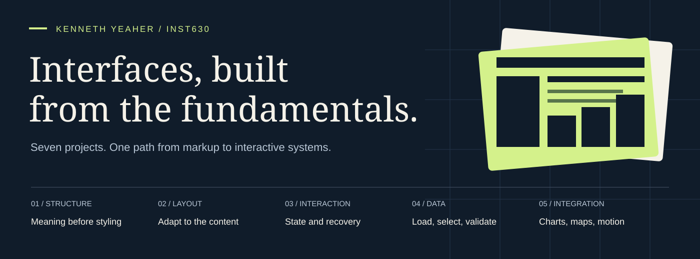
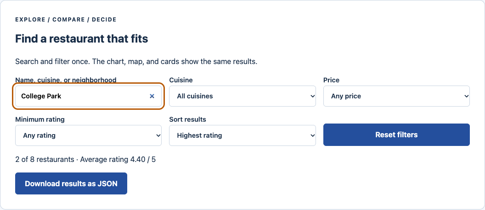
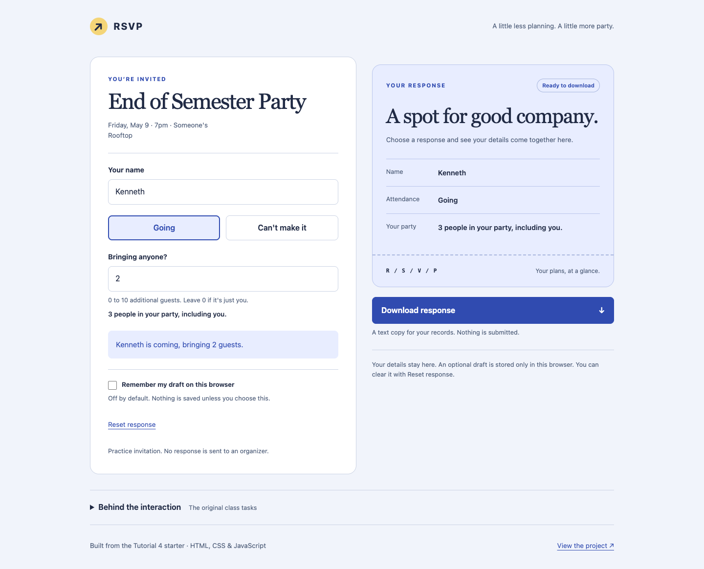
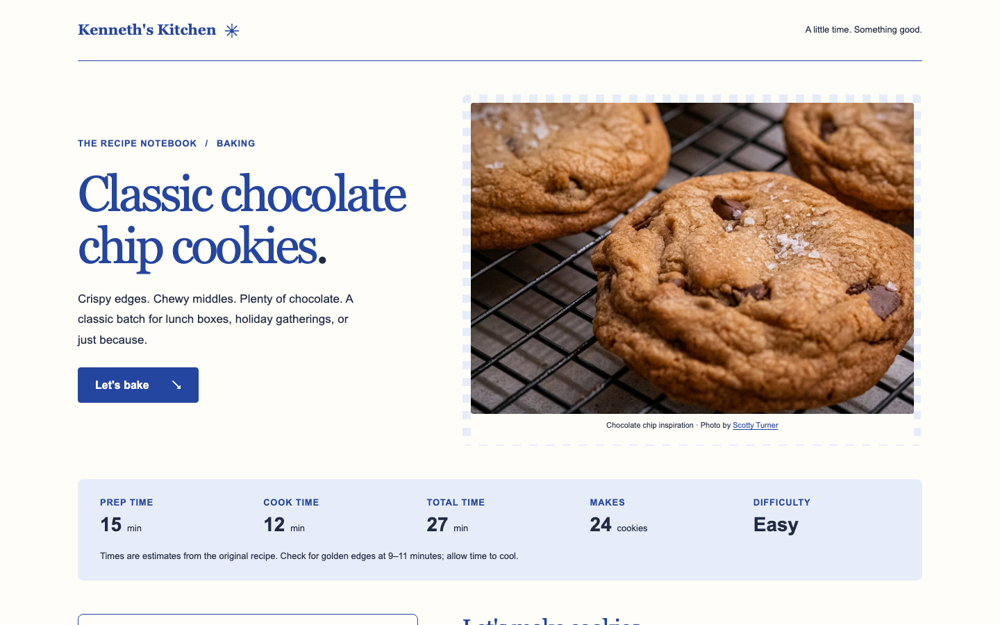
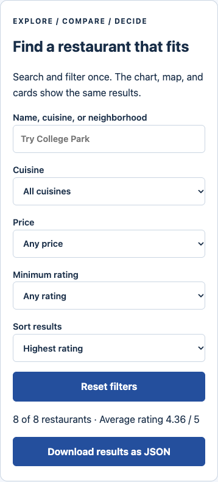
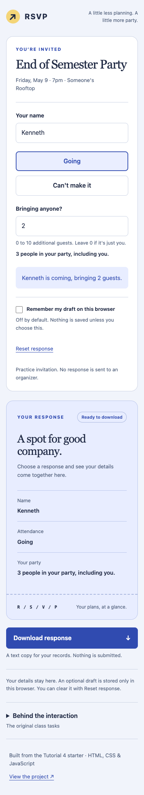
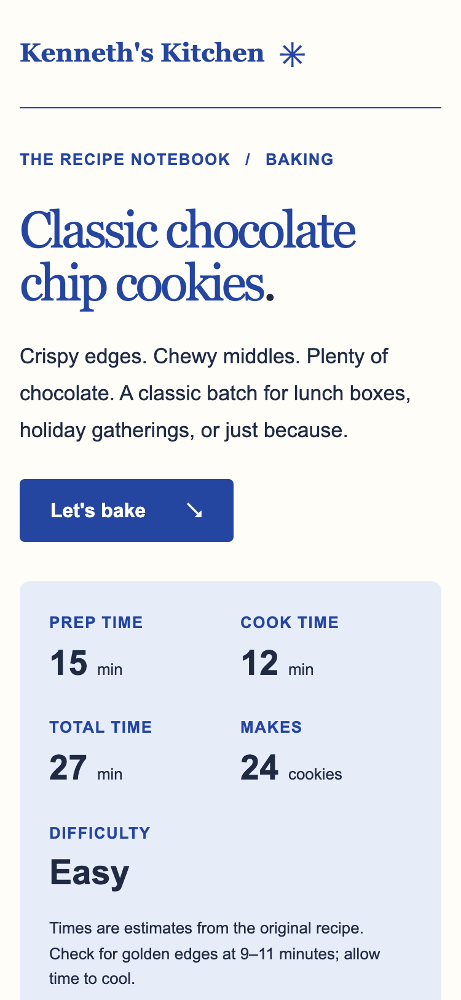

<p align="center">
  
</p>

<p align="center"><strong>Frontend development through an interaction design lens.</strong><br>
A collected body of INST630 work at the University of Maryland: semantic documents, responsive layouts, stateful interfaces, and data exploration.</p>

<p align="center">


<a href="https://github.com/kennethyeaher/inst630-web-development/actions/workflows/collection-checks.yml"></a>
</p>

<p align="center"><a href="#start-with-these-three">Selected work</a> · <a href="#the-full-collection">All seven projects</a> · <a href="docs/design-patterns.md">Design reasoning</a> · <a href="docs/midterm-guide.md">Midterm guide</a> · <a href="docs/verification.md">Verification</a></p>

## Start with these three

These projects show the clearest progression from an interface's appearance to its behavior under changing input, interrupted work, and failed dependencies. The images are browser captures from the original project repositories, not new captures of this collection.

### 01 / Restaurant library lab

**One dataset, several ways to make a decision.** Shared filters coordinate charts, a map, cards, and a temporary comparison shortlist. Chart selections narrow the collection; exact-value tables offer another route through the same data. Each library has a text fallback.



[Open original demo](https://kennethyeaher.github.io/externalLibraries/tutorial_7_external/) · [Read the project](projects/07-external-libraries/README.md) · [Inspect chart preparation](projects/07-external-libraries/tutorial_7_external/chart-data.js)

**Worth inspecting:** synchronization across views, explicit chart scales, cancellation of repeated animation, and graceful degradation. The eight restaurants are course fixtures. Map positions are illustrative because the source has no coordinates; prices and ratings are sample values.

### 02 / RSVP interaction

**A small form with a complete recovery path.** Choose an attendance response, enter guests, optionally save a draft, reset with Undo, and download a valid response. The conditional guest field makes the interface respond to the decision someone has actually made.



[Open original demo](https://kennethyeaher.github.io/addingJava/tutorial_4_files/) · [Read the project](projects/04-rsvp-interaction/README.md) · [Inspect behavior tests](projects/04-rsvp-interaction/tests/rsvp.test.cjs)

**Worth inspecting:** exclusive selection, numeric validation, optional storage, and invalid-state recovery. This is a local practice interaction; it does not register attendance or send a response to an organizer.

### 03 / Recipe redesign

**Make a reading task work as a cooking task.** A responsive recipe separates timing, ingredients, and numbered steps. Native ingredient checkboxes and a clear action work without JavaScript; the print layout retains the cooking instructions.



[Open original demo](https://kennethyeaher.github.io/uglyPageCute/) · [Read the project](projects/03-recipe-redesign/README.md) · [Review design decisions](projects/03-recipe-redesign/docs/design-notes.md)

**Worth inspecting:** semantic reading order, Grid and Flexbox responsibilities, native form behavior, and print styles. The original project includes before-and-after captures and a scoped verification record.

<details>
<summary><strong>Compare the mobile compositions</strong></summary>
<br>
<table>
<tr><th>Library lab</th><th>RSVP</th><th>Recipe</th></tr>
<tr>
<td width="33%"></td>
<td width="33%"></td>
<td width="33%"></td>
</tr>
</table>
</details>

## The full collection

The order follows the course's technical progression. Every folder is runnable on its own and includes its original project README.

| Project | Focus | Inspect | Original demo |
| --- | --- | --- | --- |
| **01 · Semantic HTML** | A course letter plus an original Correspondence companion; document structure, reading order, print | [Source and context](projects/01-semantic-html/README.md) | [Correspondence](https://kennethyeaher.github.io/KY_htmlLab/companion/) |
| **02 · Grid and Flex** | Repeated cards, nested groups, responsive stacking, an expandable layout guide | [Source and context](projects/02-grid-and-flex/README.md) | [Design Notes](https://kennethyeaher.github.io/KY_gridsFlexLab/) |
| **03 · Recipe redesign** | Hierarchy, responsive composition, native checklists, print | [Source and context](projects/03-recipe-redesign/README.md) | [Recipe](https://kennethyeaher.github.io/uglyPageCute/) |
| **04 · RSVP interaction** | DOM events, explicit state, validation, drafts, Undo | [Source and context](projects/04-rsvp-interaction/README.md) | [RSVP](https://kennethyeaher.github.io/addingJava/tutorial_4_files/) |
| **05 · Array methods** | `forEach`, `filter`, `map`, `find`; search, sort, and favorites | [Source and context](projects/05-array-methods/README.md) | [Table for eight](https://kennethyeaher.github.io/arrayMethods/tutorial_5_arrays/) |
| **06 · Async directory** | HTTP status handling, JSON validation, loading states, retry, pure model logic | [Source and context](projects/06-async-directory/README.md) | [Directory](https://kennethyeaher.github.io/asyncAndAPIs/tutorial_6_api/) |
| **07 · External libraries** | Chart.js, Leaflet, GSAP; coordinated views, comparison, exports, fallbacks | [Source and context](projects/07-external-libraries/README.md) | [Library lab](https://kennethyeaher.github.io/externalLibraries/tutorial_7_external/) |

## What connects the work

I kept the projects close to the browser: meaningful HTML, explicit CSS layout, and JavaScript where the task needs behavior. The later exercises build on the same questions as the earlier ones: what should someone notice first, what should change after an action, and how can they recover when something goes wrong?

The [design pattern notes](docs/design-patterns.md) connect specific implementations to *Designing Interfaces*, third edition, by Jenifer Tidwell, Charles Brewer, and Aynne Valencia. They explain the choices and their limits. The [midterm guide](docs/midterm-guide.md) turns the source into practice questions with answer checks.

## Run the collection

Clone this repository, then start a static server from its root:

```sh
git clone https://github.com/kennethyeaher/inst630-web-development.git
cd inst630-web-development
python3 -m http.server 8000 --bind 127.0.0.1
```

Open [the local project index](http://127.0.0.1:8000/). Each entry opens a collected application. Use HTTP rather than `file://`, because the later exercises fetch JSON and use JavaScript modules. The applications have no build step. External fonts, libraries, and map tiles require network access where used.

For verification, use Python 3 and Node.js 24 or newer:

```sh
python3 scripts/check_collection.py
python3 scripts/run_checks.py --install
```

The first command validates snapshot hashes, documentation links, and JavaScript syntax without installing packages. The second installs locked development dependencies and runs the four JavaScript projects' own checks and browser suites in Chromium. For an installed Chrome browser, use `BROWSER_CHANNEL=chrome python3 scripts/run_checks.py --install`. See [verification](docs/verification.md) for exact scope and current results.

## Source, credit, and history

This is a collected snapshot of seven existing projects, not a claim that their original development began here. [The source register](docs/source-register.md) links each original repository at the imported revision. [`catalog.json`](catalog.json) records SHA-256 hashes for every copied file. Original project history remains in those repositories; this collection's commits describe the actual assembly and documentation work.

Course starter content, exercise instructions, sample restaurant data, and supplied styles remain credited in each project. The original READMEs and verification notes are preserved as historical records; their dates, root-relative commands, and claims about a first commit refer to the original repositories. The root instructions above describe this collection. Nested CI workflows and the separate library exercise answer file are omitted; the catalog lists those exclusions. Textbooks, local notes, dependencies, and untracked material are not included.

There is no blanket license for the collection. Consult individual project credits and upstream terms before reuse. Sample data and demonstration interactions should be read in their educational context. The screenshots and automated checks do not establish full accessibility conformance, production readiness, or measured usability outcomes.

---

## Author

**Kenneth Yeaher**<br>
MS in Human Computer Interaction · University of Maryland, College Park<br>
[](https://www.linkedin.com/in/kennethyeaher/)

`Interface design` · `Frontend development` · `Interaction behavior` · `Data exploration`
