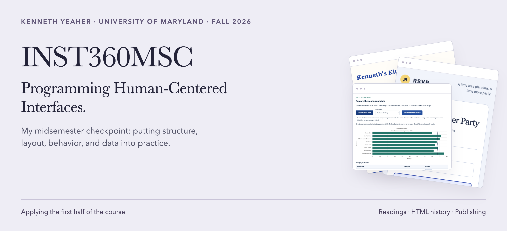
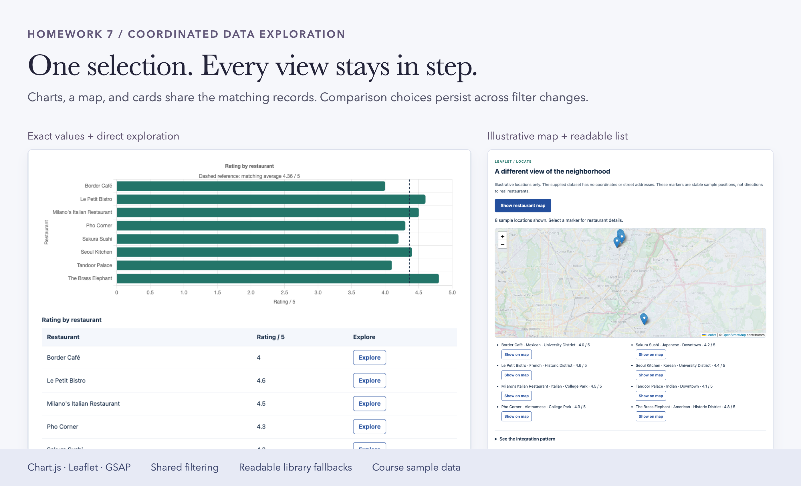
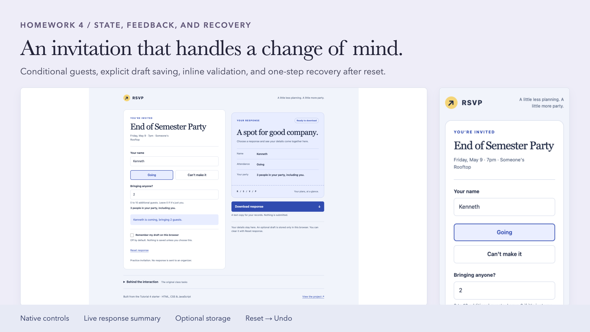
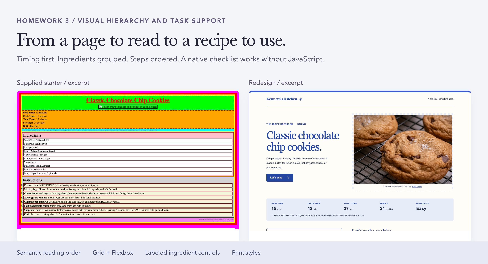
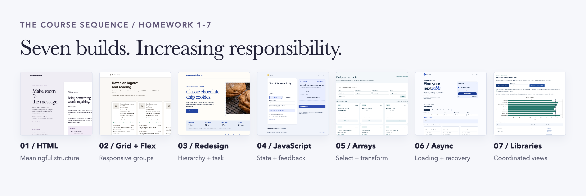

<p align="center">
<picture>
  <source media="(max-width: 600px)" srcset="docs/assets/cover-mobile.png">
  
</picture>
</p>

# INST360MSC

<p align="center"><strong>Programming Human-Centered Interfaces · Midsemester checkpoint</strong><br>
Putting the first half of the semester into practice through interface design and frontend development.</p>

This is my project for the halfway point of the course: a place to bring together what I have learned about HTML, CSS, JavaScript, data, and interaction design. The seven builds show that progression in working code, supported by design case studies and a reading companion. The [course map](docs/course-map.md) connects the work to the assignments.

<p align="center">
<a href="docs/course-map.md"></a>

<a href="https://github.com/kennethyeaher/INST360MSC/actions/workflows/collection-checks.yml"></a>
</p>

<p align="center"><a href="#selected-work">Selected work</a> · <a href="#the-full-course">The full course</a> · <a href="docs/case-studies.md">Case studies</a> · <a href="docs/reading-companion.md">Reading companion</a> · <a href="docs/midterm-guide.md">Midterm practice</a></p>

## A quick way into the work

| Review question | Start here | Look for |
| --- | --- | --- |
| Can the interface keep related views consistent? | [Restaurant library lab](docs/case-studies.md#restaurant-library-lab) | One filtered collection, multiple representations, a separate shortlist |
| What happens after a mistake or interruption? | [RSVP interaction](docs/case-studies.md#rsvp-interaction) | Validation, optional drafts, reset, and Undo |
| Does the layout support the task? | [Recipe redesign](docs/case-studies.md#recipe-redesign) | Before and after, reading order, native controls, print |
| How does this connect to the class? | [All 16 course components](docs/course-map.md) | GitPages, Homework 1–7, HTML History, and Readings 1–7 |

## Selected work

### Restaurant library lab · Homework 7

**Keep the decision consistent across views.** Search and filters define one matching collection for charts, a map, and cards. A separate shortlist retains up to three comparison choices as the visible results change. Native table actions offer the same chart exploration without requiring a pointer on the canvas.

<a href="https://kennethyeaher.github.io/externalLibraries/tutorial_7_external/"></a>

[Try the demo](https://kennethyeaher.github.io/externalLibraries/tutorial_7_external/) · [Read the case study](docs/case-studies.md#restaurant-library-lab) · [Inspect the implementation](projects/07-external-libraries/tutorial_7_external/script.js) · [Inspect browser tests](projects/07-external-libraries/tests/browser.test.cjs)

**Design reasoning:** Dynamic Queries in *Designing Interfaces* supports immediate feedback as filters change. Text tables, lists, and static cards retain the information if an individual library fails. The [shared-state diagram](docs/case-studies.md#restaurant-library-lab) explains how selection and comparison stay separate.

**Scope:** eight course sample restaurants; illustrative map positions; temporary shortlist; no current restaurant information or market claims.

### RSVP interaction · Homework 4

**A small form still needs a recovery path.** Going reveals the guest field. Invalid counts explain what to correct. Optional drafts survive a reload when saving is enabled. Reset removes the response and offers one Undo opportunity before another edit or reload.

<a href="https://kennethyeaher.github.io/addingJava/tutorial_4_files/"></a>

[Try the demo](https://kennethyeaher.github.io/addingJava/tutorial_4_files/) · [Read the case study](docs/case-studies.md#rsvp-interaction) · [Inspect state updates](projects/04-rsvp-interaction/tutorial_4_files/script.js) · [Inspect browser tests](projects/04-rsvp-interaction/tests/rsvp.test.cjs)

**Design reasoning:** Progressive Disclosure keeps guest input relevant to attendance. Norman's feedback principle supports making the choice, validation result, and reset recovery visible. The [case study](docs/case-studies.md#rsvp-interaction) traces these transitions rather than treating the form as one success state.

**Scope:** a practice invitation. Saving defaults off, the draft stays in that browser, and no response is sent to an organizer.

### Recipe redesign · Homework 3

**Organize the page around cooking.** Planning information, ingredients, and numbered instructions have different jobs. The redesign gives them a readable hierarchy, a responsive composition, native ingredient checks, and a separate print treatment.

<a href="https://kennethyeaher.github.io/uglyPageCute/"></a>

[Try the demo](https://kennethyeaher.github.io/uglyPageCute/) · [Read the case study](docs/case-studies.md#recipe-redesign) · [Inspect the document](projects/03-recipe-redesign/index.html) · [Original design notes](projects/03-recipe-redesign/docs/design-notes.md)

**Design reasoning:** Krug connects visual hierarchy to prominence, grouping, and nesting. Stimac explains how spacing expresses relationships and how semantic HTML provides a useful baseline. The checklist uses that baseline directly.

**Scope:** before-and-after captures show the design change; they do not establish faster cooking, fewer errors, or a measured usability improvement.

## The full course



This checkpoint brings together the first half of the course, including the discussion and publishing work alongside the builds.

| Course strand | Included here | Open |
| --- | --- | --- |
| **GitPages** | Publishing notes and links to the original hosted project demos | [Publishing evidence](docs/course-map.md#gitpages) |
| **Homework 1–7** | Seven runnable source snapshots with original READMEs, screenshots, credits, and existing tests | [Project directory](projects/) · [Source register](docs/source-register.md) |
| **HTML History** | A new source-backed companion linking HTML's document origins to the later interface work | [History notes](docs/reading-companion.md#html-history) |
| **Reading Assignments 1–7** | New topic companions connecting HTML, layout, design, JavaScript, data, async behavior, and libraries to the code | [Reading companion](docs/reading-companion.md) |
| **Midterm preparation** | Eight source-based practice sections with expandable answer checks | [Practice guide](docs/midterm-guide.md) |

The [full course map](docs/course-map.md) lists all 16 supplied components and the provided due dates. **Original reading responses and the HTML History discussion post were not supplied.** The companions are clearly labeled new study material; they are not represented as submitted assignments.

<details>
<summary><strong>Open any of the seven builds</strong></summary>

| Homework | Implementation | Original demo |
| --- | --- | --- |
| 1 · HTML Lab | [Course letter + Correspondence](projects/01-semantic-html/README.md) | [Open](https://kennethyeaher.github.io/KY_htmlLab/companion/) |
| 2 · Grids and Flex | [Design Notes](projects/02-grid-and-flex/README.md) | [Open](https://kennethyeaher.github.io/KY_gridsFlexLab/) |
| 3 · Make An Ugly Page Cute | [Recipe redesign](projects/03-recipe-redesign/README.md) | [Open](https://kennethyeaher.github.io/uglyPageCute/) |
| 4 · Adding JavaScript | [RSVP interaction](projects/04-rsvp-interaction/README.md) | [Open](https://kennethyeaher.github.io/addingJava/tutorial_4_files/) |
| 5 · Array Methods For Data | [Table for eight](projects/05-array-methods/README.md) | [Open](https://kennethyeaher.github.io/arrayMethods/tutorial_5_arrays/) |
| 6 · Async/Await and APIs | [Restaurant directory](projects/06-async-directory/README.md) | [Open](https://kennethyeaher.github.io/asyncAndAPIs/tutorial_6_api/) |
| 7 · External Libraries | [Restaurant library lab](projects/07-external-libraries/README.md) | [Open](https://kennethyeaher.github.io/externalLibraries/tutorial_7_external/) |

</details>

## Design reasoning you can trace

The [reading register](docs/design-patterns.md#reading-register) gives verified page locations in four supplied books: *Designing Interfaces*, Norman's *The Design of Everyday Things*, Krug's *Don't Make Me Think, Revisited*, and Stimac's *Design for Developers*. Each connection points to a behavior or composition in the source and explains its limits.

The [case studies](docs/case-studies.md) follow the problem, implementation, reading connection, failure path, and evidence. The [visual system](docs/visual-system.md) documents how the presentation uses hierarchy, grouping, and spacing. Textbook PDFs and page imagery are not redistributed.

## Run and inspect

```sh
git clone https://github.com/kennethyeaher/INST360MSC.git
cd INST360MSC
python3 -m http.server 8000 --bind 127.0.0.1
```

Open [the local project index](http://127.0.0.1:8000/). Each entry opens a collected application. Use HTTP for the later JSON and module-based exercises. There is no application build step; external libraries, fonts, and map tiles need network access where used.

With Python 3 and Node.js 24 or newer:

```sh
python3 scripts/check_collection.py
python3 scripts/run_checks.py --install
```

The first command verifies source hashes, local documentation targets, and JavaScript syntax. The second installs locked development packages and runs the four JavaScript projects' existing checks and browser suites. Use `BROWSER_CHANNEL=chrome` for an installed Chrome browser. The [verification record](docs/verification.md) separates current collection checks, dated project results, and remaining manual checks.

## Evidence, credit, and history

All 115 copied source files are registered by revision and hash in [`catalog.json`](catalog.json). Original development history remains in the seven linked repositories. Collection commits record actual assembly, documentation, and presentation work. The artwork arranges earlier browser captures; it does not depict newly tested application states.

<details>
<summary><strong>Source boundaries and reuse</strong></summary>

Course starter content, supplied styles, sample records, and third party assets retain their credits inside the project folders. The original READMEs and verification notes keep their historical context: their root commands, dates, and first-commit descriptions refer to the original repositories. [The source register](docs/source-register.md) lists the exact imported revisions and exclusions.

No blanket license is added for supplied course content or other credited material. Consult upstream terms before reuse. The root instructions describe this collection. Nested original CI workflows and the separate supplied library answer file are omitted; private notes, textbooks, dependencies, and untracked files are excluded.

Automated checks and screenshot review do not establish full accessibility conformance, production readiness, or measured usability outcomes. [Verification](docs/verification.md) records the actual scope.

</details>

---

**Kenneth Yeaher**<br>
MS in Human Computer Interaction · University of Maryland, College Park<br>
[GitHub](https://github.com/kennethyeaher) · [LinkedIn](https://www.linkedin.com/in/kennethyeaher/)
