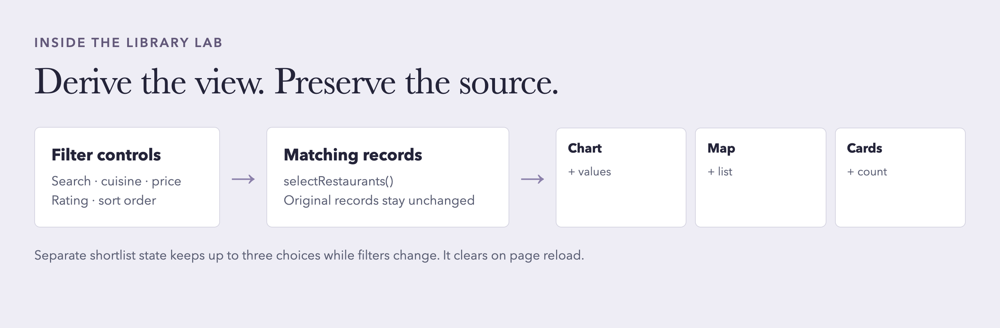
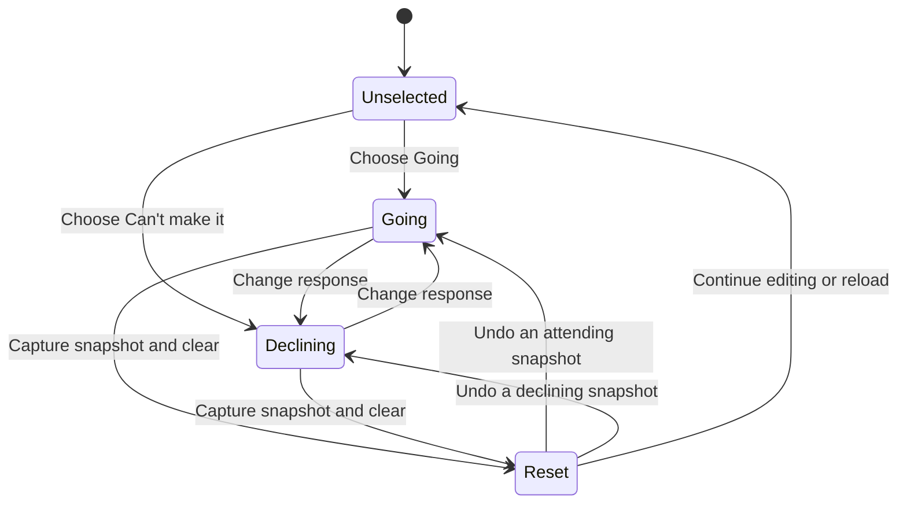

# Three case studies

These studies explain existing implementations and the design reasoning that supports them. They do not claim a user study, measured improvement, or a production release. Screenshots are presentation crops of earlier browser captures, with the original files retained in each project. [Reading references](design-patterns.md#reading-register) give the editions and verified page locations.

## Restaurant library lab

**The problem.** Charts, a map, and a list can appear to describe different collections if each view owns its own filtering. A person comparing restaurants also needs a way to retain choices while narrowing the visible results.

**The implementation.** [`getSelectedRestaurants()`](../projects/07-external-libraries/tutorial_7_external/script.js) derives one matching array from the controls. `updateExplorer()` refreshes cards, requested visualizations, result feedback, and comparison. A separate `Set` stores up to three comparison IDs, so a filter change does not discard the shortlist. Ratings are exact source values; the chart's dashed reference is the matching sample mean. Ordered price tiers are not measured dollar amounts.

**The reading connection.** Dynamic Queries in *Designing Interfaces* (PDF page 707) connects familiar controls with immediate changes in the visible dataset. Norman's mapping principle (printed page 23; PDF page 37) is relevant to the relationship between selecting a bar or table action and the resulting filter. This is an application of the principle, not an equivalence to the physical-control examples in the book.

**The failure path.** A missing Chart.js library leaves the exact-value table; a missing Leaflet library leaves a text list; a missing GSAP library leaves static cards. Replaying an animation cancels the earlier animation. Reduced motion preserves visible content without the entrance effect.

**Inspect the evidence.** [`tests/browser.test.cjs`](../projects/07-external-libraries/tests/browser.test.cjs) exercises synchronization, the three-choice cap, blocked libraries, exact chart values, exports, keyboard alternatives, and reduced motion. [`tests/data.test.cjs`](../projects/07-external-libraries/tests/data.test.cjs) checks transformations and validation.

**The boundary.** Eight fixture records do not establish a restaurant-market trend. Locations are illustrative. Shortlist state is temporary and clears on reload. The interface still requires JavaScript even when an individual library has a fallback.

[Open original demo](https://kennethyeaher.github.io/externalLibraries/tutorial_7_external/) · [Full project context](../projects/07-external-libraries/README.md)

## RSVP interaction

**The problem.** A two-choice attendance form still has complicated transitions: invalid guests, a switched response, interrupted input, an accidental reset, or blocked storage. Each transition should leave the visible response and available actions consistent.

**The implementation.** [`updateResponse()`](../projects/04-rsvp-interaction/tutorial_4_files/script.js) synchronizes visual selection, `aria-pressed`, conditional guest input, validation, and summary. `resetCard()` captures one response snapshot, clears the form and saved draft, and exposes Undo. `undoReset()` restores that snapshot once. The next edit clears the recovery opportunity. Draft storage is an explicit preference and defaults off.

**The reading connection.** Progressive Disclosure (*Designing Interfaces*, PDF page 365) explains why guests become relevant after Going. Norman's feedback principle (printed page 27; PDF page 41) supports showing the selected state and the effect of reset or restoration. Input Hints and Error Messages (*Designing Interfaces*, PDF pages 753 and 801) connect the allowed range to correction guidance.

The diagram summarizes attendance transitions. It omits names, validation detail, optional storage, and resetting an already unselected form. A reload after a reset does not restore the in-memory Undo snapshot.

**Inspect the evidence.** [`tests/rsvp.test.cjs`](../projects/04-rsvp-interaction/tests/rsvp.test.cjs) covers exclusive choices, invalid guest counts, draft lifecycle, corrupt or blocked storage, reset recovery, downloads, keyboard input, and selected layout settings.

**The boundary.** This is a practice invitation. Nothing is sent to an organizer. Guest validation affects attending responses, while declining does not require a valid guest count. Full screen-reader compatibility is not established by the browser tests.

[Open original demo](https://kennethyeaher.github.io/addingJava/tutorial_4_files/) · [Full project context](../projects/04-rsvp-interaction/README.md)

## Recipe redesign

**The problem.** A recipe is used in stages: decide whether to cook, gather ingredients, then follow instructions. A page can contain all the words yet make the current task difficult to locate.

**The implementation.** [The HTML](../projects/03-recipe-redesign/index.html) separates recipe identity, timing, image, ingredients, and numbered instructions. A native ingredient form supplies labeled checkboxes and reset behavior. [The CSS](../projects/03-recipe-redesign/style.css) defines page regions with Grid, aligns smaller groups with Flexbox, adapts the composition to narrow widths, and changes what is printed.

**The reading connection.** Krug (PDF pages 56–58) ties prominence, grouping, and nesting to how someone reads a page at a glance. Stimac (PDF page 465) explains how space communicates relationships; the ingredient list and instructions need internal grouping as well as separation from neighboring sections. Stimac's progressive-enhancement discussion (PDF page 519) also supports using native HTML for the checklist.

**Inspect the evidence.** The original [design notes](../projects/03-recipe-redesign/docs/design-notes.md) document checks of responsive widths, native checklist behavior, enlarged text, and print layout, with dates and limits. These are historical checks, separate from the collection's current documentation validation.

**The boundary.** Before-and-after screenshots show a visual change. They do not establish shorter cooking time or fewer mistakes. The preserved notes do not claim a complete accessibility audit or physical printing test.

[Open original demo](https://kennethyeaher.github.io/uglyPageCute/) · [Full project context](../projects/03-recipe-redesign/README.md)
